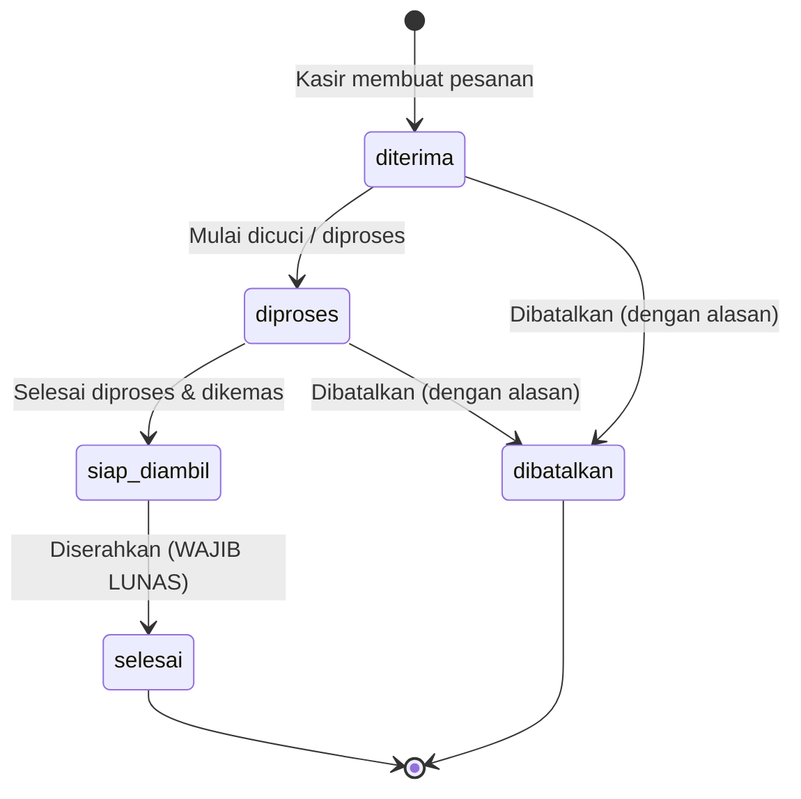
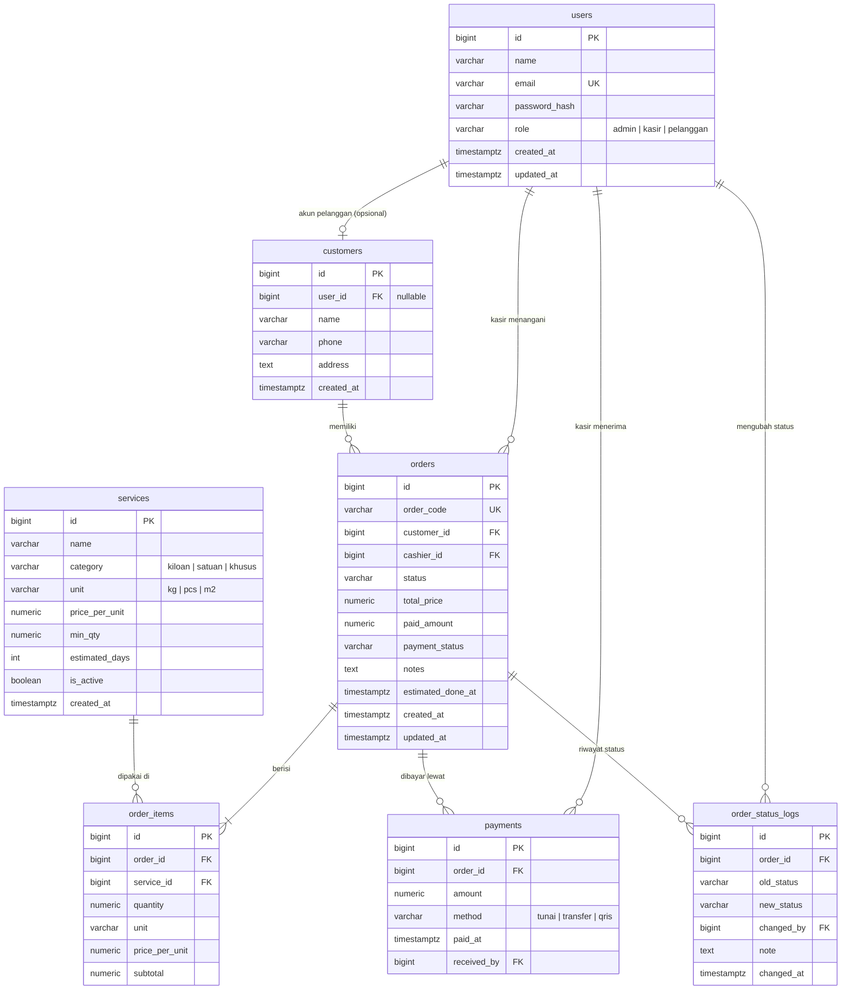
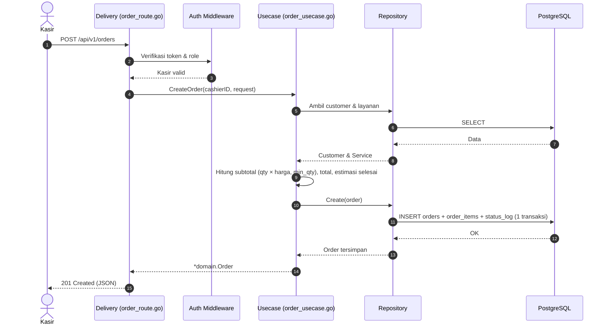

# LAPORAN RANCANGAN SISTEM & BOILERPLATE BACKEND
# CLEANNEST: SISTEM MANAJEMEN LAUNDRY (KILOAN & SATUAN)

| | |
|---|---|
| **Mata Kuliah** | Praktikum Pemrograman Backend Lanjut |
| **Kelompok** | 3 (TI-C1) |
| **Repositori GitHub (public)** | [ISI LINK REPOSITORI] |
| **Batas Pengumpulan** | 18 November 2026, pukul 23.59 WIB |

| No | Nama | NIM | Peran | Branch |
|:--:|---|:--:|---|---|
| 1 | Angelyna Rahmah Ramadhani | 434241006 | Database & Domain Engineer | `feat/domain-and-repo` |
| 2 | Nasywa Ashilah Fairuz Zahra | 434241010 | Business Logic (Usecase) Engineer | `feat/usecase-logic` |
| 3 | Fanny Rahmadinata | 434241009 | Delivery Engineer & **Git Master** | `feat/delivery-and-config` |

---

## BAB I — PENDAHULUAN

### 1.1 Latar Belakang
Usaha laundry di sekitar kampus dan perumahan tidak hanya melayani cucian **kiloan**. Pelanggan juga membawa barang **satuan** seperti bed cover, jas, dan selimut, serta barang **khusus** seperti sepatu dan karpet. Tiap jenis barang dihitung dengan satuan berbeda (per kg, per potong, per m²) dan butuh waktu pengerjaan berbeda.

Banyak laundry kecil masih mencatat transaksi di nota kertas. Akibatnya:
1. Nota mudah hilang atau tertukar, sehingga sering terjadi selisih soal berat, jumlah barang, atau harga.
2. Pelanggan tidak bisa mengecek progres cucian tanpa datang atau menelepon.
3. Perhitungan harga campuran (kiloan + satuan) rawan salah hitung, dan pembayaran DP/cicilan tidak tercatat rapi.
4. Pemilik sulit merekap pendapatan harian/bulanan per metode pembayaran (tunai, transfer, QRIS).

### 1.2 Rumusan Masalah
1. Bagaimana merancang backend laundry yang mendukung banyak satuan harga (kg, pcs, m²) dalam satu pesanan?
2. Bagaimana menerapkan Clean Architecture di Go sesuai modul perkuliahan (tanpa controller/handler)?
3. Bagaimana memastikan aturan bisnis (alur status, pelunasan, minimum order) berjalan konsisten?
4. Bagaimana membagi pekerjaan tim secara terukur melalui micro commits di GitHub?

### 1.3 Tujuan
1. Membangun boilerplate backend REST API **CleanNest** dengan Go dan Clean Architecture.
2. Menyediakan fitur pencatatan pesanan laundry kiloan, satuan, dan khusus beserta perhitungan harga otomatis.
3. Memberikan pelacakan status cucian kepada pelanggan menggunakan kode pesanan.
4. Menyediakan laporan pendapatan bagi pemilik usaha.

---

## BAB II — GAMBARAN UMUM SISTEM

### 2.1 Nama dan Deskripsi Sistem
**CleanNest** (dari *clean* = bersih dan *nest* = sarang/rumah, yaitu "rumah bagi pakaian bersih") adalah sistem backend untuk manajemen usaha laundry yang menangani:
- **Laundry kiloan**: cuci setrika reguler, cuci kering lipat, express (harga per kg, dengan minimum berat).
- **Laundry satuan**: bed cover, jas/dry clean, selimut (harga per pcs).
- **Laundry khusus**: cuci sepatu (per pcs), cuci karpet/gorden (per m²).

Satu pesanan dapat berisi campuran layanan. Contoh: 4 kg pakaian + 1 bed cover + 1 pasang sepatu. Sistem menghitung subtotal setiap item, total tagihan, dan estimasi selesai secara otomatis.

### 2.2 Role pada Sistem

<!-- tabel: Role dan hak akses utama -->
| Role | Deskripsi | Hak Akses Utama |
|---|---|---|
| **Admin** (pemilik) | Mengelola usaha | Kelola akun kasir, kelola katalog layanan & harga, lihat semua pesanan, laporan pendapatan harian/bulanan |
| **Kasir** (operator) | Melayani transaksi di outlet | Daftarkan pelanggan walk-in, buat pesanan, ubah status cucian, catat pembayaran, batalkan pesanan |
| **Pelanggan** | Pengguna jasa | Registrasi & login, lihat riwayat pesanan sendiri, lacak status cucian via kode pesanan |

### 2.3 Matriks Hak Akses (RBAC)

<!-- tabel: Matriks hak akses (RBAC) -->
| Fitur / Endpoint | Admin | Kasir | Pelanggan | Publik |
|---|:--:|:--:|:--:|:--:|
| Health check, katalog layanan, lacak pesanan via kode | ✅ | ✅ | ✅ | ✅ |
| Registrasi pelanggan, login | – | – | – | ✅ |
| Kelola kasir (tambah, lihat, hapus) | ✅ | – | – | – |
| Kelola layanan (tambah, ubah, hapus) | ✅ | – | – | – |
| Laporan pendapatan harian & bulanan | ✅ | – | – | – |
| Kelola pelanggan (tambah, lihat) | ✅ | ✅ | – | – |
| Buat pesanan, ubah status, batalkan, daftar pesanan | ✅ | ✅ | – | – |
| Catat & lihat pembayaran | ✅ | ✅ | – | – |
| Riwayat pesanan milik sendiri | – | – | ✅ | – |
| Detail pesanan by ID | ✅ | ✅ | ✅ (hanya milik sendiri) | – |

---

## BAB III — FITUR & ATURAN BISNIS

### 3.1 Fitur per Role

**Admin**
1. Manajemen akun kasir (email unik).
2. Katalog layanan: nama, **kategori** (kiloan/satuan/khusus), **satuan** (kg/pcs/m²), harga per satuan, minimum kuantitas, estimasi hari, status aktif.
3. Monitoring seluruh pesanan dengan filter status, pelanggan, dan rentang tanggal.
4. Laporan pendapatan harian dan bulanan, dipecah per metode pembayaran.

**Kasir**
1. Mendaftarkan pelanggan walk-in (nama, telepon, alamat).
2. Membuat pesanan berisi satu atau lebih item layanan dengan kuantitas sesuai satuannya.
3. Memperbarui status pesanan sesuai alur.
4. Mencatat pembayaran lunas atau sebagian (DP).
5. Membatalkan pesanan dengan alasan.

**Pelanggan**
1. Registrasi dan login mandiri.
2. Melacak status dan riwayat perubahan status pesanan lewat kode pesanan (tanpa login).
3. Melihat riwayat seluruh pesanan miliknya.

### 3.2 Rumus Perhitungan Harga

Setiap item pesanan dihitung berdasarkan satuan layanannya:

```
qty_ditagih_i  = max(quantity_i, min_qty_layanan_i)
subtotal_i     = qty_ditagih_i × price_per_unit_i
total_tagihan  = Σ subtotal_i
estimasi_selesai = waktu_pesanan + max(estimated_days_i) hari
```

**Contoh:** pesanan berisi 2 kg *Cuci Setrika Reguler* (Rp7.000/kg, minimum 3 kg) + 4,5 m² *Cuci Karpet* (Rp15.000/m²):

<!-- tabel: Contoh perhitungan pesanan campuran -->
| Item | Kuantitas | Ditagih | Harga | Subtotal |
|---|---|---|---|---|
| Cuci Setrika Reguler | 2 kg | 3 kg (minimum) | 7.000/kg | 21.000 |
| Cuci Karpet | 4,5 m² | 4,5 m² | 15.000/m² | 67.500 |
| **Total** | | | | **88.500** |

> **Snapshot harga:** satuan dan harga per satuan disalin ke tabel `order_items` saat pesanan dibuat. Jika admin mengubah harga layanan, total pesanan lama tidak ikut berubah.

### 3.3 Alur Status Pesanan

Alur status dibuat umum agar cocok untuk semua jenis layanan (sepatu dan karpet tidak melalui tahap setrika):



<!-- tabel: Transisi status yang diizinkan -->
| Status Saat Ini | Status Berikutnya | Syarat |
|---|---|---|
| `diterima` | `diproses` / `dibatalkan` | Pembatalan wajib disertai alasan |
| `diproses` | `siap_diambil` / `dibatalkan` | – |
| `siap_diambil` | `selesai` | `payment_status` harus `lunas` |
| `selesai`, `dibatalkan` | – | Status akhir, tidak dapat diubah |

Setiap perubahan status dicatat di tabel `order_status_logs` (siapa, kapan, dari status apa ke status apa).

### 3.4 Aturan Pembayaran
1. `payment_status`: `belum` (terbayar 0), `sebagian` (0 < terbayar < total), `lunas` (terbayar = total).
2. Pembayaran yang melebihi sisa tagihan ditolak (`ErrPaymentExceedsTotal`).
3. Metode pembayaran: `tunai`, `transfer`, `qris`.

---

## BAB IV — RANCANGAN DATABASE

### 4.1 ERD



### 4.2 Kamus Data

**1. `users`**: akun semua aktor.

<!-- tabel: Struktur tabel users -->
| Kolom | Tipe | Keterangan |
|---|---|---|
| id | BIGSERIAL PK | |
| name | VARCHAR(150) | Nama lengkap |
| email | VARCHAR(150) UNIQUE | Email login |
| password_hash | VARCHAR(255) | Hash PBKDF2-SHA256 dengan salt acak per pengguna |
| role | VARCHAR(20) | `admin`, `kasir`, `pelanggan` |
| created_at, updated_at | TIMESTAMPTZ | |

**2. `customers`**: data pelanggan. `user_id` boleh kosong untuk pelanggan walk-in tanpa akun.

<!-- tabel: Struktur tabel customers -->
| Kolom | Tipe | Keterangan |
|---|---|---|
| id | BIGSERIAL PK | |
| user_id | BIGINT FK → users, NULL | Akun pelanggan (opsional) |
| name | VARCHAR(150) | |
| phone | VARCHAR(30) | Nomor WhatsApp |
| address | TEXT NULL | |
| created_at | TIMESTAMPTZ | |

**3. `services`**: katalog layanan laundry.

<!-- tabel: Struktur tabel services -->
| Kolom | Tipe | Keterangan |
|---|---|---|
| id | BIGSERIAL PK | |
| name | VARCHAR(100) | Contoh: Cuci Setrika Reguler, Bed Cover, Cuci Sepatu |
| category | VARCHAR(20) | `kiloan`, `satuan`, `khusus` |
| unit | VARCHAR(10) | `kg`, `pcs`, `m2` |
| price_per_unit | NUMERIC(12,2) | Harga per satuan, > 0 |
| min_qty | NUMERIC(8,2) | Minimum kuantitas yang ditagih (0 = tanpa minimum) |
| estimated_days | INT | Estimasi lama pengerjaan (hari) |
| is_active | BOOLEAN | Layanan nonaktif tidak dapat dipesan |
| created_at | TIMESTAMPTZ | |

**4. `orders`**: header pesanan.

<!-- tabel: Struktur tabel orders -->
| Kolom | Tipe | Keterangan |
|---|---|---|
| id | BIGSERIAL PK | |
| order_code | VARCHAR(50) UNIQUE | Kode pelacakan, contoh `CN-202611181930-4821` |
| customer_id | BIGINT FK → customers | |
| cashier_id | BIGINT FK → users | Kasir pembuat pesanan |
| status | VARCHAR(30) | `diterima`, `diproses`, `siap_diambil`, `selesai`, `dibatalkan` |
| total_price | NUMERIC(12,2) | Σ subtotal item |
| paid_amount | NUMERIC(12,2) | Total yang sudah dibayar |
| payment_status | VARCHAR(20) | `belum`, `sebagian`, `lunas` |
| notes | TEXT | Catatan khusus |
| estimated_done_at | TIMESTAMPTZ | Estimasi selesai |
| created_at, updated_at | TIMESTAMPTZ | |

**5. `order_items`**: rincian item per pesanan.

<!-- tabel: Struktur tabel order_items -->
| Kolom | Tipe | Keterangan |
|---|---|---|
| id | BIGSERIAL PK | |
| order_id | BIGINT FK → orders | |
| service_id | BIGINT FK → services | |
| quantity | NUMERIC(8,2) | Jumlah dalam satuan layanan (kg / pcs / m²), > 0 |
| unit | VARCHAR(10) | Snapshot satuan |
| price_per_unit | NUMERIC(12,2) | Snapshot harga saat transaksi |
| subtotal | NUMERIC(12,2) | max(quantity, min_qty) × price_per_unit |

**6. `payments`**: riwayat pembayaran (mendukung cicilan/DP).

<!-- tabel: Struktur tabel payments -->
| Kolom | Tipe | Keterangan |
|---|---|---|
| id | BIGSERIAL PK | |
| order_id | BIGINT FK → orders | |
| amount | NUMERIC(12,2) | > 0 |
| method | VARCHAR(20) | `tunai`, `transfer`, `qris` |
| paid_at | TIMESTAMPTZ | |
| received_by | BIGINT FK → users | Kasir penerima |

**7. `order_status_logs`**: jejak audit perubahan status.

<!-- tabel: Struktur tabel order_status_logs -->
| Kolom | Tipe | Keterangan |
|---|---|---|
| id | BIGSERIAL PK | |
| order_id | BIGINT FK → orders | |
| old_status, new_status | VARCHAR(30) | |
| changed_by | BIGINT FK → users | |
| note | TEXT | Catatan / alasan pembatalan |
| changed_at | TIMESTAMPTZ | |

### 4.3 Migrasi
- `migrations/000001_init_schema.up.sql` / `.down.sql`: DDL 7 tabel, CHECK constraint, foreign key, dan index.
- `migrations/000002_seed_data.up.sql` / `.down.sql`: akun admin & kasir default serta 7 layanan contoh (kiloan, satuan, khusus).

---

## BAB V — ARSITEKTUR BACKEND (CLEAN ARCHITECTURE)

### 5.1 Prinsip
Arah dependensi hanya mengarah ke dalam: `delivery → usecase → domain ← repository`. Lapisan `domain` tidak mengenal HTTP maupun database, sehingga aturan bisnis dapat diuji tanpa server dan tanpa database fisik.

### 5.2 Tanpa Controller & Handler
Sesuai ketentuan tugas, lapisan terluar diberi nama **`delivery`**. Tidak ada file atau struct bernama `controller` atau `handler`. Struct `Router` mendaftarkan rute, dan setiap rute diarahkan ke fungsi `serveXxx` yang hanya melakukan tiga hal: membaca request, memanggil usecase, dan menulis response JSON. Seluruh logika bisnis berada di `usecase`.

### 5.3 Struktur Folder

```text
cleannest/
├── cmd/main.go                    # Entry point & dependency injection
├── config/config.go               # Konfigurasi environment & DSN PostgreSQL
├── pkg/security/password.go       # Hash password PBKDF2-SHA256
├── migrations/                    # DDL & seed data SQL
└── internal/
    ├── domain/                    # Entitas, konstanta, error, interface repository
    │   ├── user.go  customer.go  service.go  order.go  payment.go  errors.go
    ├── usecase/                   # Aturan bisnis
    │   ├── auth_usecase.go  customer_usecase.go  service_usecase.go
    │   ├── order_usecase.go  payment_usecase.go  report_usecase.go
    ├── repository/                # Implementasi PostgreSQL & in-memory
    │   ├── user_repository.go  customer_repository.go  service_repository.go
    │   ├── order_repository.go  payment_repository.go  memory_repository.go
    └── delivery/                  # Lapisan HTTP (tanpa controller/handler)
        ├── router.go              # Registrasi rute
        ├── system_route.go  auth_route.go  cashier_route.go  service_route.go
        ├── customer_route.go  order_route.go  payment_route.go  report_route.go
        ├── response.go            # Format JSON standar
        └── middleware/auth_middleware.go   # JWT & otorisasi role
```

### 5.4 Alur Request (Contoh: Membuat Pesanan)



---

## BAB VI — SPESIFIKASI API

### 6.1 Daftar Endpoint (25)

<!-- tabel: Daftar endpoint REST API -->
| No | Method | Endpoint | Akses | Fungsi |
|:--:|---|---|---|---|
| 1 | GET | `/` | Publik | Info API |
| 2 | GET | `/api/v1/health` | Publik | Cek server |
| 3 | POST | `/api/v1/auth/register` | Publik | Registrasi pelanggan |
| 4 | POST | `/api/v1/auth/login` | Publik | Login, mendapat token JWT |
| 5 | GET | `/api/v1/services` | Publik | Katalog layanan aktif |
| 6 | GET | `/api/v1/orders/track?code=` | Publik | Lacak pesanan |
| 7 | POST | `/api/v1/admin/cashiers` | Admin | Tambah kasir |
| 8 | GET | `/api/v1/admin/cashiers` | Admin | Daftar kasir |
| 9 | DELETE | `/api/v1/admin/cashiers/{id}` | Admin | Hapus kasir |
| 10 | POST | `/api/v1/admin/services` | Admin | Tambah layanan |
| 11 | PUT | `/api/v1/admin/services/{id}` | Admin | Ubah layanan |
| 12 | DELETE | `/api/v1/admin/services/{id}` | Admin | Hapus layanan |
| 13 | GET | `/api/v1/admin/reports/daily` | Admin | Laporan harian |
| 14 | GET | `/api/v1/admin/reports/monthly` | Admin | Laporan bulanan |
| 15 | POST | `/api/v1/customers` | Admin, Kasir | Tambah pelanggan walk-in |
| 16 | GET | `/api/v1/customers` | Admin, Kasir | Daftar pelanggan |
| 17 | GET | `/api/v1/customers/{id}` | Admin, Kasir | Detail pelanggan |
| 18 | POST | `/api/v1/orders` | Admin, Kasir | Buat pesanan |
| 19 | GET | `/api/v1/orders` | Admin, Kasir | Daftar pesanan (filter) |
| 20 | PATCH | `/api/v1/orders/{id}/status` | Admin, Kasir | Ubah status |
| 21 | POST | `/api/v1/orders/{id}/cancel` | Admin, Kasir | Batalkan pesanan |
| 22 | POST | `/api/v1/payments` | Admin, Kasir | Catat pembayaran |
| 23 | GET | `/api/v1/payments/order/{orderId}` | Admin, Kasir | Riwayat pembayaran |
| 24 | GET | `/api/v1/customer/orders` | Pelanggan | Riwayat pesanan sendiri |
| 25 | GET | `/api/v1/orders/{id}` | Semua role login | Detail pesanan (pelanggan hanya miliknya) |

### 6.2 Contoh Payload

**Tambah layanan (Admin)**: `POST /api/v1/admin/services`
```json
{
  "name": "Cuci Gorden",
  "category": "khusus",
  "unit": "m2",
  "price_per_unit": 12000,
  "min_qty": 0,
  "estimated_days": 3
}
```

**Buat pesanan campuran (Kasir)**: `POST /api/v1/orders`
```json
{
  "customer_id": 1,
  "notes": "Karpet ada noda kopi",
  "items": [
    { "service_id": 1, "quantity": 2 },
    { "service_id": 7, "quantity": 4.5 }
  ]
}
```

**Response (201 Created)**, diringkas:
```json
{
  "success": true,
  "message": "pesanan laundry berhasil dibuat",
  "data": {
    "id": 1,
    "order_code": "CN-202611182008-3113",
    "status": "diterima",
    "total_price": 88500,
    "payment_status": "belum",
    "items": [
      { "service_name": "Cuci Setrika Reguler", "quantity": 2, "unit": "kg",
        "price_per_unit": 7000, "subtotal": 21000 },
      { "service_name": "Cuci Karpet", "quantity": 4.5, "unit": "m2",
        "price_per_unit": 15000, "subtotal": 67500 }
    ]
  }
}
```

**Ubah status**: `PATCH /api/v1/orders/1/status`
```json
{ "new_status": "diproses", "note": "Masuk mesin cuci" }
```

**Catat pembayaran**: `POST /api/v1/payments`
```json
{ "order_id": 1, "amount": 50000, "method": "qris" }
```

---

## BAB VII — KOLABORASI GIT

### 7.1 Alur Kerja
1. Git Master membuat repositori public dan commit awal (`go.mod`, `.gitignore`, `.env.example`).
2. Setiap anggota meng-clone repositori, membuat branch fitur, lalu melakukan **micro commit** (satu commit untuk satu perubahan kecil) dari akun GitHub masing-masing.
3. Setiap anggota melakukan push dan membuat **Pull Request** ke `main`.
4. Git Master me-review, menyelesaikan konflik jika ada, lalu melakukan merge ke `main`.

### 7.2 Pembagian Commit

**Angelyna Rahmah Ramadhani: `feat/domain-and-repo`**

<!-- tabel: Pembagian commit Angelyna Rahmah Ramadhani -->
| No | Pesan Commit | File |
|:--:|---|---|
| 1 | `feat(domain): add common domain errors` | `internal/domain/errors.go` |
| 2 | `feat(domain): add user and customer entities` | `domain/user.go`, `domain/customer.go` |
| 3 | `feat(domain): add service entity with unit and category` | `domain/service.go` |
| 4 | `feat(domain): add order, order item, and status log entities` | `domain/order.go` |
| 5 | `feat(domain): add payment entity and repository contract` | `domain/payment.go` |
| 6 | `feat(migration): create schema for 7 tables` | `migrations/000001_*` |
| 7 | `feat(migration): seed default accounts and laundry services` | `migrations/000002_*` |
| 8 | `feat(repo): implement user and customer postgres repository` | `repository/user_repository.go`, `customer_repository.go` |
| 9 | `feat(repo): implement service postgres repository` | `repository/service_repository.go` |
| 10 | `feat(repo): implement order and payment postgres repository` | `repository/order_repository.go`, `payment_repository.go` |
| 11 | `feat(repo): add in-memory store with seed data` | `repository/memory_repository.go` |

**Nasywa Ashilah Fairuz Zahra: `feat/usecase-logic`**

<!-- tabel: Pembagian commit Nasywa Ashilah Fairuz Zahra -->
| No | Pesan Commit | File |
|:--:|---|---|
| 1 | `feat(security): add pbkdf2 password hashing` | `pkg/security/password.go` |
| 2 | `test(security): add password hashing tests` | `pkg/security/password_test.go` |
| 3 | `feat(usecase): add auth usecase (register, login, jwt, cashier)` | `usecase/auth_usecase.go` |
| 4 | `feat(usecase): add customer usecase` | `usecase/customer_usecase.go` |
| 5 | `feat(usecase): add service catalog usecase with unit validation` | `usecase/service_usecase.go` |
| 6 | `feat(usecase): add order usecase with pricing and status flow` | `usecase/order_usecase.go` |
| 7 | `feat(usecase): add payment usecase with partial payment` | `usecase/payment_usecase.go` |
| 8 | `feat(usecase): add revenue report usecase` | `usecase/report_usecase.go` |

**Fanny Rahmadinata (Git Master): `feat/delivery-and-config`**

<!-- tabel: Pembagian commit Fanny Rahmadinata (Git Master) -->
| No | Pesan Commit | File |
|:--:|---|---|
| 1 | `feat(config): add environment config loader` | `config/config.go` |
| 2 | `feat(delivery): add standard json response helper` | `delivery/response.go` |
| 3 | `feat(middleware): add jwt authentication and role guard` | `delivery/middleware/auth_middleware.go` |
| 4 | `feat(delivery): add router and route registration` | `delivery/router.go` |
| 5 | `feat(delivery): add system and auth routes` | `system_route.go`, `auth_route.go` |
| 6 | `feat(delivery): add cashier, service, and customer routes` | `cashier_route.go`, `service_route.go`, `customer_route.go` |
| 7 | `feat(delivery): add order routes with ownership check` | `order_route.go` |
| 8 | `feat(delivery): add payment and report routes` | `payment_route.go`, `report_route.go` |
| 9 | `feat(cmd): wire dependencies and start server` | `cmd/main.go` |
| 10 | `test(delivery): add endpoint and order flow tests` | `router_test.go`, `order_flow_test.go` |
| 11 | `docs: add readme and system design report` | `README.md`, `docs/` |

### 7.3 Bukti Commit
[TEMPEL SCREENSHOT halaman *Commits*, *Pull requests (closed)*, dan *Insights → Network* dari repositori GitHub]

---

## BAB VIII — PENGUJIAN & CARA MENJALANKAN

### 8.1 Pengujian Otomatis
```bash
go test ./...
```
Cakupan pengujian:
- `TestRouterEndpoints`: root, health check, dan katalog layanan.
- `TestLoginRejectsWrongPassword`: login dengan password salah ditolak (401).
- `TestOrderFlowKiloanDanSatuan`: pesanan campuran kiloan + satuan dengan minimum kg (total 46.000), penolakan lompat status, penolakan `selesai` saat belum lunas, pembayaran, penyelesaian pesanan, dan pelanggan lain yang tidak dapat melihat pesanan (404).
- `TestHashAndCheckPassword`, `TestPBKDF2KnownVector`: hash password, diuji dengan vektor uji standar RFC.

### 8.2 Menjalankan Aplikasi
**Mode in-memory** (tanpa database, data contoh otomatis tersedia):
```bash
go run ./cmd
```

**Mode PostgreSQL**:
```bash
createdb cleannest_db
psql -d cleannest_db -f migrations/000001_init_schema.up.sql
psql -d cleannest_db -f migrations/000002_seed_data.up.sql
USE_SQL_DB=true DB_NAME=cleannest_db go run ./cmd
```

Akun default: `admin@cleannest.com` / `password123` dan `kasir@cleannest.com` / `password123`.

Kebutuhan: Go 1.22 atau lebih baru; PostgreSQL bersifat opsional.

---

## BAB IX — PENUTUP

### 9.1 Kesimpulan
1. CleanNest dirancang sebagai backend laundry yang mendukung layanan kiloan, satuan, dan khusus dalam satu pesanan melalui konsep **satuan harga** (kg/pcs/m²) dan **minimum kuantitas**.
2. Backend dibangun dengan Go dan Clean Architecture (domain, usecase, repository, delivery) tanpa controller/handler, dan dapat berjalan dengan PostgreSQL maupun in-memory.
3. Aturan bisnis utama (perhitungan harga, alur status, wajib lunas sebelum selesai, pembayaran bertahap, pembatasan akses pelanggan) berada di lapisan usecase dan telah diuji otomatis.
4. Pengerjaan dibagi ke tiga anggota melalui branch fitur, micro commit, dan pull request yang di-merge oleh Git Master.

### 9.2 Pengembangan Lanjutan
1. Layanan antar-jemput (pickup & delivery) dengan ongkos kirim.
2. Notifikasi WhatsApp otomatis saat status berubah menjadi `siap_diambil`.
3. Integrasi payment gateway untuk QRIS dinamis.
4. Membership dan poin loyalitas pelanggan.
